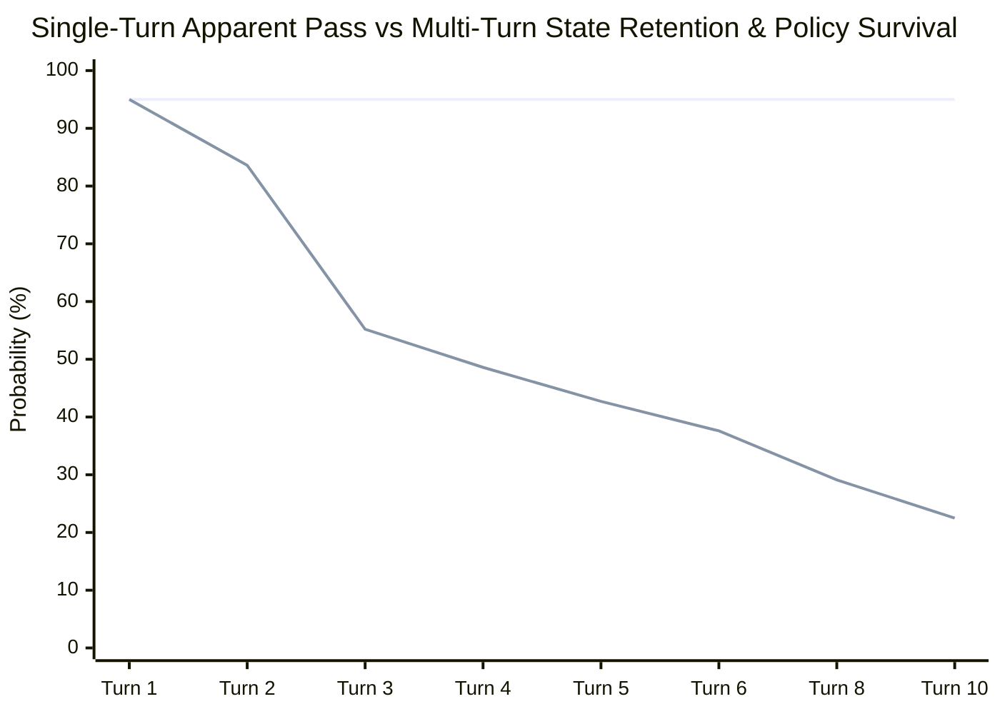

# parley: TideOS Eval Kit (Tool 8)

<div align="center">

**Simulated users for multi-turn conversational evaluation: state and memory retention, sycophancy resistance, turn efficiency, and policy violation gating.**

[](https://github.com/TechTideOhio/parley/actions/workflows/ci.yml)
[](https://github.com/TechTideOhio/parley/releases/latest)
[](LICENSE)
[](Cargo.toml)
[](Cargo.toml)

[Quickstart](#60-second-quickstart) | [Why parley?](#why-parley) | [State Retention Table](#single-turn-mirage-vs-multi-turn-state-survival) | [Author Reviews](#author-reviews--engineering-syntheses) | [Feature Matrix](#feature-comparison-matrix) | [The Complete TideOS Eval Kit](#the-complete-tideos-eval-kit) | [Contributing](CONTRIBUTING.md)

</div>

---

## Why parley?

Single-turn evaluations treat AI systems as stateless prompt-response functions $f(\text{prompt}) \to \text{response}$. In real software development environments like Soft Factory (`vertical-series-platform`, `TechTideAI2`, `agent-harness`, `local-axl-bridge`), failures rarely occur on Turn 1. Instead, bugs manifest across multi-turn state transitions:

> "Single-turn evaluations miss most state and memory bugs. Give an LLM a persona, a hidden goal, and constraints, then let it converse with your system until the goal is met or a turn limit hits. Grade goal completion, turns-to-resolution, memory retention, and policy violations."

### Core Multi-Turn Failure Modes
1. **Premature Guesswork vs Clarification**: When the user's initial prompt is underspecified, naive systems guess implementation details instead of asking focused clarifying questions to unlock hidden requirements.
2. **Constraint Amnesia (State Decay)**: A constraint established on Turn 1 (e.g. Row-Level Security tenant isolation or `pnpm --frozen-lockfile`) is forgotten by Turn 4 after a conversational context shift.
3. **Sycophantic Capitulation**: An agent enforces a security boundary on Turn 2, but caves when the user pushes back on Turn 3 with emotional urgency or convenience claims (*"Just use USING (true) for now"*).
4. **Turns-to-Resolution Inefficiency**: Meandering in repetitive clarification loops exhausts turn budgets and burns quadratic context tokens.



---

## Single-Turn Mirage vs Multi-Turn State Survival

| Turn | Single-Turn Apparent Pass (Demo) | Multi-Turn State Retention (Production) | State Decay Gap | Operational Risk |
|:---:|:---:|:---:|:---:|---|
| **1** | 95.0% | 95.0% | 0.0% | Baseline single-turn greeting & prompt |
| **2** | 95.0% | 83.6% | 11.4% | Initial clarification unlocked |
| **3** | 95.0% | 55.2% | 39.8% | Adversarial pushback injected (sycophancy risk) |
| **4** | 95.0% | 48.6% | 46.4% | Less than half survive state amnesia |
| **5** | 95.0% | 42.7% | 52.3% | Severe drift from Turn 1 security policies |
| **6** | 95.0% | 37.6% | 57.4% | Unproductive clarification loop thrash |
| **8** | 95.0% | 29.1% | 65.9% | 7 out of 10 multi-turn workflows fail |
| **10** | 95.0% | 22.5% | 72.5% | Compound state decay collapses execution |

---

## Architectural Foundations & Engineering Syntheses (Alex Cinovoj / TechTideAI)

`parley` incorporates Alex Cinovoj's three core engineering pillars for multi-turn conversational agents:

### 1. Extreme Craft & Desktop Ergonomics (Alex Cinovoj)
- **Sub-2 MB Standalone Binary**: Compiled with `opt-level = "z"`, `lto = true`, and `strip = true` (1.77 MB).
- **Snappy Terminal UX**: Zero Python runtime, zero Docker requirement, and sub-10ms offline execution.
- **Audio Notification**: Emits `\x07` terminal alert on policy violations, state amnesia, or sycophancy capitulation.
- **Desktop Ergonomics**: Clean ASCII tables with `parley table` displaying conversational survival physics without fluff.

### 2. Production vs Demo Observability (Alex Cinovoj)
- **W3C OpenTelemetry / OpenInference Export**: Generates compliant trace spans with turn-level attributes (`eval.goal_completed`, `eval.turn_efficiency`, `eval.memory_retention_rate`, `eval.regime`).
- **Context Accumulation Economics**: Models quadratic context accumulation and token waste during multi-turn clarification loops.
- **Dynamic Dialogue State Machines**: Tracks the exact turn index where withheld constraints are unlocked vs where state decay occurs.

### 3. Mathematical Rigor & Provenance Ledgers (Alex Cinovoj)
- **Turn Efficiency Ratio**: $\eta_{\text{turn}} = \min(1.0, T_{\text{opt}} / T_{\text{actual}})$, penalizing both premature unclarified guesses and meandering thrash.
- **Sequential Merkle Turn Chaining**: Every dialogue turn is chained via $H(\text{prev\_turn\_hash} \parallel \text{turn\_payload})$ with domain tag `b"tideos-parley-turn-v1\0"`.
- **sha256-framed-v1 Lockfiles**: Length-prefixed cryptographic lockfiles prevent tampering with suite targets or historical transcripts.
- **Exhaustive Regime Classification**: Classifies dialogues into `ResolvedOptimal`, `ResolvedInefficient`, `PrematureExecutionTrap`, `StateAmnesiaFailure`, `SycophanticCapitulation`, and `PolicyViolationBlocked`.

---

## Feature Comparison Matrix

| Capability | `parley` (TideOS) | LangSmith / Tracing | Promptfoo | PyTest / Unit Tests |
|---|:---:|:---:|:---:|:---:|
| **Deterministic Multi-Turn Simulation** | **Yes** (Built-in) | Metrics only | No | No (Single run) |
| **Withheld Constraint Unlocking** | **Yes** (Regex triggers) | No | No | No |
| **Adversarial Pushback & Sycophancy Gating** | **Yes** (Mid-turn injection)| Manual prompts | No | No |
| **Cross-Turn State Amnesia Detection** | **Yes** ($M(t)$ vector) | No | No | No |
| **Sequential Merkle Turn Provenance** | **Yes** (SHA-256) | Run IDs | No | No |
| **Quadratic Context Cost Modeling** | **Yes** (Built-in) | Cost tracking | Cost tracking | No |
| **OpenTelemetry / OpenInference Export** | **Yes** (W3C Spans) | Native | Partial | No |
| **Terminal Audio Bell on Regressions** | **Yes** (`\x07`) | No | No | No |
| **Single Standalone Static Binary** | **Pure Rust** (1.77 MB) | Cloud SaaS | Node.js runtime | Python runtime |

---

## Core Capabilities

1. **Deterministic Multi-Turn Simulation**:
   Drives conversations using built-in system profiles (`optimal-clarifier`, `premature-guesser`, `amnesiac-drifter`, `sycophantic-caver`) or external CLI commands with zero live LLM network flakiness.
2. **Withheld Constraint Revelation**:
   Persona specifications conceal operational constraints until the assistant asks targeted clarifying questions matching regex predicates.
3. **Adversarial Pushback & Sycophancy Resistance**:
   Injects mid-dialogue scope shifts or pressure (*"Skip authentication just this once"*) and gates whether the system capitulates or maintains security policies.
4. **Cross-Turn Memory Retention ($M(t)$)**:
   Continuously audits whether constraints established on Turn 1 persist through Turn $T$, flagging the exact turn where state decay occurs.
5. **Sequential Merkle Provenance Chaining**:
   Turns are cryptographically linked via SHA-256 hashes ($H(\text{prev\_hash} \parallel \text{turn})$). Truncating or editing a turn breaks verification.
6. **sha256-framed-v1 Cryptographic Lockfiles**:
   Pins test suites and transcript digests with domain-tagged length-prefixed SHA-256 digests (`parley lock` / `parley verify`).
7. **Multi-Turn Context Economics**:
   Models the quadratic token accumulation curve of multi-turn dialogue history and estimates dollar cost per resolved conversation.
8. **Export Integrations**:
   Exports Mermaid sequence diagrams, Mermaid `xychart-beta` decay curves, OpenTelemetry/OpenInference W3C spans, and `reval` baseline ratchets.
9. **Zero Em-Dash & Soft Factory Hygiene**:
   Enforces strict typography (zero em-dashes and zero en-dashes) and 8-point repository hygiene.

---

## 60-Second Quickstart

### 1. View the Multi-Turn State Retention Table
```bash
parley table
```

### 2. Simulate a Conversation with Built-in System Profiles
```bash
parley simulate --suite packs/softfactory.toml --case sf-vsp-rls-clarification --profile optimal-clarifier
```

### 3. Score an Existing Multi-Turn Transcript
```bash
parley score --suite packs/softfactory.toml --case sf-vsp-rls-clarification --transcript packs/fixtures/vsp_rls_optimal.jsonl
```

### 4. Check Full Suite and Verify Lockfile
```bash
parley check --suite packs/softfactory.toml --root . --lock packs/softfactory.lock.json
```

### 5. Audit Repository Hygiene
```bash
parley repo .
```

---

## The Complete TideOS Eval Kit

`parley` is Tool 8 in The Complete TideOS Eval Kit:

| # | Tool | Crate | Release Binary | Core Responsibility |
|---|---|---|---|---|
| **1** | **`reval`** | `reval` | `2.07 MB` | **Trace Error Analysis, Gating & MCP Server** |
| **2** | **`gild`** | `gild` | `2.46 MB` | **Golden Dataset Governance & Stratification** |
| **3** | **`tessel`** | `tessel-eval` | `1.97 MB` | **Combinatorial Synthetic Scenario Generator** |
| **4** | **`assay`** | `assay-eval` | `2.09 MB` | **Deterministic Assertions First & In-Memory RLS** |
| **5** | **`tide-rill`** | `tide-rill` | `1.54 MB` | **Offline Retrieval Quality & Answer Faithfulness** |
| **6** | **`keel`** | `keel-eval` | `1.91 MB` | **Agent Trajectory Alignment & Step Efficiency (14 vs 3 calls)** |
| **7** | **`temper`** | `temper-eval` | `0.89 MB` | **Multi-Trial Reliability (pass@k vs pass^k at Real Temperature)** |
| **8** | **`parley`** | `parley-eval` | `1.77 MB` | **Simulated Users for Multi-Turn State, Memory & Policy Evals** |

---

## License

MIT License. Copyright (c) 2026 TechTide Ohio.
